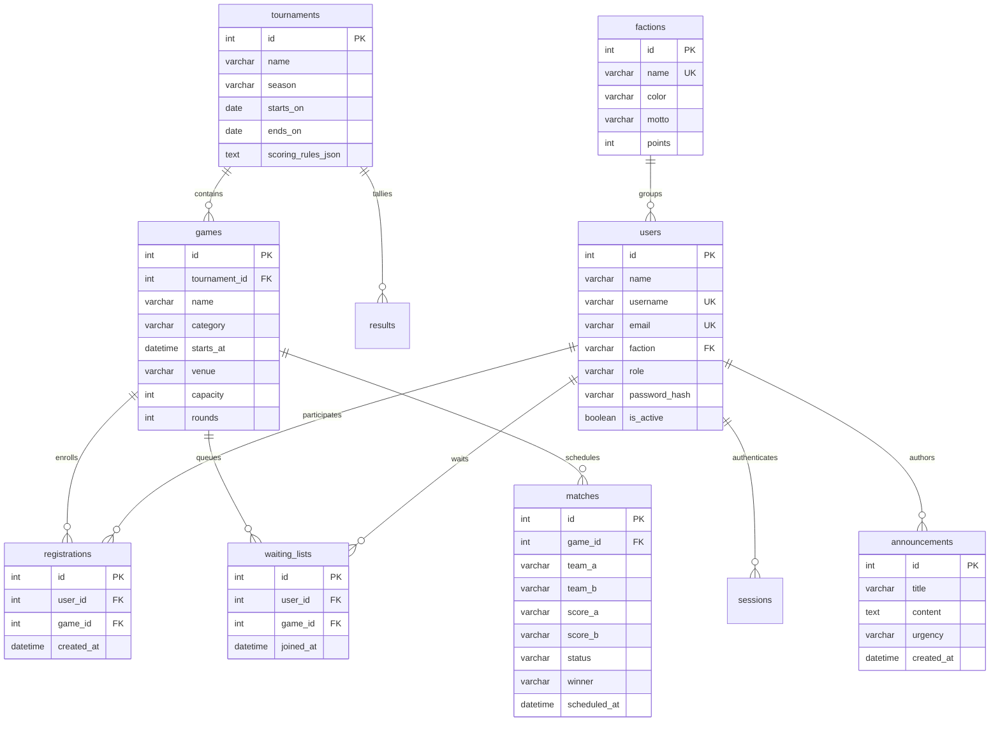

# ARENA — College Sports Tournament Management System
## Comprehensive Technical Documentation, Architecture & Viva Guide

---

## 1. Executive Summary & System Overview

**ARENA** is an enterprise-grade College Sports Tournament Management System engineered to orchestrate multi-sport athletic meets, campus leagues, and collegiate tournaments. The system seamlessly unifies high-throughput sports operations—such as multi-event registration, automated waiting lists, live match scoring, faction championships, and venue scheduling—with a pedagogical **Data Structures & Algorithms Laboratory** (`/lab`) implemented from scratch in pure Python.

### Architectural Philosophy
- **Zero Third-Party DS/Algo Dependencies**: All fundamental data structures (Singly Linked List, Linked Stack, Linked Queue, Binary Tree, Binary Search Tree, Graph Adjacency List) and algorithms (Shunting-Yard Infix/Postfix, Linear Search, Binary Search, Merge Sort, Selection Sort, Multi-Venue Greedy Scheduler) are implemented from first principles without standard library wrappers (`collections.deque`, `heapq`, `bisect`, etc.).
- **Dual Perspective**: Operates simultaneously as a production-grade responsive tournament platform for collegiate athletes & tournament directors, and as an interactive testbed exposing granular algorithmic step traces, state visualizers, and empirical runtime benchmarks.
- **Data Integrity & Backwards Compatibility**: Preserves all existing database relations and unit tests while adding scalable schema extensions for college factions, live scoreboards, match fixtures, waiting lists, and announcements.

---

## 2. Technology Stack & Directory Topology

```
c:\Arena\project (C:\game_tour_ds)
├── backend/
│   ├── algorithms/
│   │   ├── __init__.py
│   │   ├── expression_handler.py     # Shunting-yard infix->postfix, postfix evaluator & traces
│   │   ├── problem_solver.py         # Multi-venue greedy scheduler with conflict resolution
│   │   └── search_sort.py            # Linear/Binary search & Merge/Selection sort with step traces
│   ├── data_structures/
│   │   ├── __init__.py
│   │   ├── graph.py                  # Adjacency List, custom Queue-driven BFS & DFS with queue traces
│   │   ├── linked_list.py            # Singly Linked List (insert/delete by pos/val/id, search, traverse)
│   │   ├── queue.py                  # FIFO Queue using linked nodes
│   │   ├── stack.py                  # LIFO Stack using linked nodes
│   │   └── tree.py                   # BST (delete 0/1/2 children, min/max, traversals) & Bracket Tree
│   ├── tests/
│   │   ├── test_arena_extensions.py  # 8 comprehensive tests for new custom DS/Algo features
│   │   ├── test_phase_requirements.py# Phase 1-4 validation tests
│   │   ├── test_real_world_validation.py # Auth, security, and input constraint tests
│   │   └── test_tournament_deletion.py  # Atomic transactional cascade deletion tests
│   ├── app.py                        # REST API routing, session auth, CORS, and DS Lab endpoints
│   ├── database.py                   # MySQL connection pooling, schema migrations, and relational queries
│   ├── schema.sql                    # Initial relational schema definition
│   └── venv/                         # Python 3.14 virtual environment
└── frontend/
    ├── app/
    │   ├── components/
    │   │   ├── role.tsx              # User context, session state, and fetch wrapper
    │   │   ├── SiteShell.tsx         # Sidebar navigation, theme toggler, and layout wrapper
    │   │   ├── structures-demo.tsx   # Client-side mirror demonstrations
    │   │   └── ui.tsx                # Reusable UI primitives (Card, PageTitle, SectionHeading, Tag)
    │   ├── algorithms/page.tsx       # Search & Sort exploration with Search & Find banner
    │   ├── factions/page.tsx         # Faction championship standings, roster, and transfer
    │   ├── lab/page.tsx              # Search & Find (HTML5 Canvas Game Flow Map, Player Lineups, Score Calculator)
    │   ├── leaderboard/page.tsx      # Student individual points leaderboard
    │   ├── my-events/page.tsx        # Student confirmed entries & waiting list queue monitor
    │   ├── participants/page.tsx     # Student roster & account activation management
    │   ├── profile/page.tsx          # Student profile, faction badge & event ledger
    │   ├── results/page.tsx          # Placement-based point scoring & audit log
    │   ├── schedule/page.tsx         # Venue lane timetable, collision detector & Phase 4 solver
    │   ├── sports/page.tsx           # Sports catalogue, single enroll & waiting list
    │   ├── structures/page.tsx       # Operations desk with Search & Find banner
    │   ├── tournament/page.tsx       # Tournament & game creation/editing
    │   ├── globals.css               # Design system, CSS variables, and canvas styling
    │   └── page.tsx                  # ARENA Dashboard (KPIs, ticker, schedule timeline)
    ├── next.config.ts                # Standalone output & /api proxy to http://127.0.0.1:8000
    └── tsconfig.json                 # TypeScript strict configuration
```

---

## 3. Database Schema & Relational Entity Model

The MySQL persistence layer (`backend/database.py`) operates with foreign key enforcement and transactional rollbacks.



### Automated Promotion Engine
When a student withdraws from a sport via `POST /api/withdraw`:
1. The student's record is atomically removed from `registrations`.
2. The waiting list for `game_id` is queried for the earliest queued participant (`ORDER BY joined_at ASC LIMIT 1` acting as a database-backed FIFO Queue).
3. If a student is waiting, they are immediately enrolled into `registrations` and removed from `waiting_lists`.
4. The remaining queue positions advance seamlessly without administrative intervention.

---

## 4. Syllabus Mapping: Data Structures & Algorithms

### Phase 1: Linear Data Structures & Applications

| Requirement | Implementation File | Python Class / Method | UI Location | Key Features |
|---|---|---|---|---|
| **Singly Linked List** | `backend/data_structures/linked_list.py` | `LinkedList` | `/lab?tab=phase1`<br>`/structures` | `insert_at_start()`, `insert_at_end()`, `insert_at_position()`, `delete_by_value()`, `delete_by_student_id()`, `delete_at_position()`, `search()`, `traverse()`. Preserves tail reference for $O(1)$ append. |
| **Linked Stack** | `backend/data_structures/stack.py` | `Stack` | `/lab?tab=phase1`<br>`/structures` | `push()`, `pop()`, `peek()`, `is_empty()`, `display()`. Pure linked node implementation with LIFO semantics. |
| **Linked Queue** | `backend/data_structures/queue.py` | `Queue` | `/lab?tab=phase1`<br>`/my-events` | `enqueue()`, `dequeue()`, `peek()`, `get_front()`, `display()`. Maintained with both head and tail pointers for $O(1)$ enqueue and dequeue. |
| **Expression Evaluator** | `backend/algorithms/expression_handler.py` | `evaluate_expression_detailed()` | `/lab?tab=phase1` | Shunting-Yard Infix to Postfix conversion + Postfix evaluation using custom linked Stack. Tracks operator precedence, associativity, parentheses balancing, unary +/- signs, division-by-zero guards, and outputs a step-by-step trace table. |

### Phase 2: Hierarchical & Graph Structures

| Requirement | Implementation File | Python Class / Method | UI Location | Key Features |
|---|---|---|---|---|
| **Binary Tree Bracket** | `backend/data_structures/tree.py` | `TournamentBinaryTree` | `/lab?tab=phase2` | Hierarchical binary tree modeling tournament elimination brackets (Finals $\rightarrow$ Semifinals $\rightarrow$ Quarterfinals). Computes Preorder, Inorder, and Postorder traversals with educational navigation semantics. |
| **Binary Search Tree** | `backend/data_structures/tree.py` | `BinarySearchTree` | `/lab?tab=phase2` | Full BST implementation with `insert()`, `search()`, `find_min()`, `find_max()`, and complete 3-case `delete()` (Leaf node, Single-child, and Two-child node replaced with in-order successor). |
| **Graph Adjacency List** | `backend/data_structures/graph.py` | `Graph` | `/lab?tab=phase2`<br>`/structures` | Campus venue topology representation. Implements **BFS using our custom linked Queue**, capturing exact queue state snapshots at each exploration step. Also implements DFS. |

### Phase 3: Searching, Sorting & Complexity Benchmarks

| Requirement | Implementation File | Python Class / Method | UI Location | Key Features |
|---|---|---|---|---|
| **Linear Search** | `backend/algorithms/search_sort.py` | `linear_search_detailed()` | `/lab?tab=phase3`<br>`/algorithms` | Step-by-step sequential inspection comparing targets against student rosters. Emits comparison count and index findings. |
| **Binary Search** | `backend/algorithms/search_sort.py` | `binary_search_detailed()` | `/lab?tab=phase3`<br>`/algorithms` | Logarithmic boundary convergence tracing `low`, `high`, `mid` pointers and narrowing interval bounds until match or empty space. |
| **Merge Sort** | `backend/algorithms/search_sort.py` | `merge_sort_detailed()` | `/lab?tab=phase3`<br>`/algorithms` | Divide-and-conquer sorting algorithm. Captures recursive tree splitting and two-pointer merged array assembly at every step. Non-mutating and stable. |
| **Selection Sort** | `backend/algorithms/search_sort.py` | `selection_sort()` | `/algorithms` | In-place minimum extraction algorithm with quadratic comparisons. |
| **Runtime Benchmarks** | `backend/algorithms/search_sort.py` | `benchmark_search_sort()` | `/lab?tab=phase3` | Microsecond empirical execution timing across array sizes $N = 10, 50, 100, 250, 500$ verifying theoretical asymptotic models. |

### Phase 4: Optimization, Multi-Venue Scheduling & Real-World Integration

| Requirement | Implementation File | Python Class / Method | UI Location | Key Features |
|---|---|---|---|---|
| **Greedy Interval Scheduler** | `backend/algorithms/problem_solver.py` | `schedule_tournament_events()` | `/schedule`<br>`/lab?tab=phase4` | Multi-venue Earliest Finish Time (EFT) greedy algorithm. Resolves two dimensions of conflict: (1) venue availability overlap and (2) participant schedule clashes. Emits decision traces for each candidate match. |
| **Schedule Persistence** | `backend/app.py` | `POST /api/schedule/save-greedily` | `/schedule` | Allows tournament directors to commit greedily optimized schedules directly to MySQL tournament fixture tables. |
| **Live Match Center** | `backend/app.py`, `database.py` | `POST/PUT /api/matches` | `/live`<br>`/matches` | Real-time score recording, round transitions, and winner declaration with automatic faction points updating. |

---

## 5. Algorithmic Complexity Reference Table

| Data Structure / Algorithm | Operation / Scenario | Best Case Time | Average Case Time | Worst Case Time | Auxiliary Space |
|---|---|---|---|---|---|
| **Singly Linked List** | Prepend (`insert_at_start`) | $O(1)$ | $O(1)$ | $O(1)$ | $O(1)$ |
| | Append (`insert_at_end` with tail) | $O(1)$ | $O(1)$ | $O(1)$ | $O(1)$ |
| | Positional Insert / Delete | $O(1)$ at head | $O(N)$ | $O(N)$ at tail | $O(1)$ |
| | Search by Value / ID | $O(1)$ | $O(N)$ | $O(N)$ | $O(1)$ |
| **Linked Stack** | Push / Pop / Peek | $O(1)$ | $O(1)$ | $O(1)$ | $O(1)$ per op |
| **Linked Queue** | Enqueue / Dequeue / Peek | $O(1)$ | $O(1)$ | $O(1)$ | $O(1)$ per op |
| **Shunting-Yard Parser** | Infix $\rightarrow$ Postfix | $O(N)$ | $O(N)$ | $O(N)$ | $O(N)$ |
| **Postfix Evaluator** | Postfix Expression Evaluation | $O(N)$ | $O(N)$ | $O(N)$ | $O(N)$ |
| **Binary Search Tree** | Search / Insert / Delete | $O(1)$ (root) | $O(\log N)$ (balanced) | $O(N)$ (skewed) | $O(H)$ recursion |
| **Binary Tree Traversals** | Inorder / Preorder / Postorder | $O(N)$ | $O(N)$ | $O(N)$ | $O(H)$ stack |
| **Graph (Adj List)** | Breadth-First Search (BFS) | $O(V + E)$ | $O(V + E)$ | $O(V + E)$ | $O(V)$ queue |
| | Depth-First Search (DFS) | $O(V + E)$ | $O(V + E)$ | $O(V + E)$ | $O(V)$ recursion |
| **Linear Search** | Find item in array of size $N$ | $O(1)$ (first item) | $O(N)$ | $O(N)$ (last / absent) | $O(1)$ |
| **Binary Search** | Find item in sorted array | $O(1)$ (mid item) | $O(\log N)$ | $O(\log N)$ | $O(1)$ iterative |
| **Merge Sort** | Sort array of size $N$ | $O(N \log N)$ | $O(N \log N)$ | $O(N \log N)$ | $O(N)$ merge buffer |
| **Selection Sort** | Sort array of size $N$ | $O(N^2)$ | $O(N^2)$ | $O(N^2)$ | $O(1)$ in-place |
| **Greedy Scheduler** | Sort intervals + EFT greedy pass | $O(M \log M)$ | $O(M \log M)$ | $O(M \log M)$ | $O(M)$ |

*Where $N$ = elements, $V$ = vertices, $E$ = edges, $H$ = tree height, $M$ = match candidate intervals.*

---

## 6. Technical Defense & Viva Voce Q&A

### Q1: Why use custom linked nodes for Stack and Queue instead of Python's built-in `list`?
**Answer:** A Python `list` is implemented internally as a dynamic contiguous array (`std::vector`-like in CPython). Calling `list.pop(0)` or `list.insert(0, val)` requires shifting all remaining elements in memory, yielding $O(N)$ time complexity. In contrast, our custom `Node`-based `Queue` maintains explicit `_front` and `_rear` references, allowing `enqueue()` and `dequeue()` in guaranteed $O(1)$ time regardless of scale. Similarly, our `Stack` prepends to the linked chain for guaranteed $O(1)$ `push()` and `pop()`.

### Q2: How does the Shunting-Yard algorithm handle operator precedence and associativity?
**Answer:** The Shunting-Yard algorithm processes tokens from left to right. When an operator $op_1$ arrives, operators on the stack $op_2$ are popped to output if they have higher precedence, or equal precedence with left-associativity. Left parenthesis `(` is pushed unconditionally to establish an evaluation frame. When `)` is encountered, the stack is popped to output until the matching `(` is discarded. Unary negation (`-5`) is detected by inspecting preceding token state and evaluated via a high-precedence unary modifier.

### Q3: How is node deletion handled in a Binary Search Tree when the node has two children?
**Answer:** When deleting a node $Z$ with two children:
1. We locate $Z$'s **in-order successor** $Y$ (the node with the minimum key in $Z$'s right subtree: `y = self._find_min(node.right)`).
2. $Y$ is guaranteed to have at most one child (a right child), because if it had a left child, that left child would be smaller and thus would have been the successor instead.
3. We copy $Y$'s key and value into $Z$.
4. We recursively delete $Y$ from the right subtree: `node.right = self._delete(node.right, successor.key)`. This reduces the problem to Case 1 (leaf) or Case 2 (single child).

### Q4: Why must BFS use a Queue, and what happens if a Stack is used instead?
**Answer:** BFS discovers vertices in order of their shortest-path distance (edge count) from the root. Because a Queue enforces First-In, First-Out (FIFO) ordering, all vertices at depth $d$ are enqueued and processed before any vertices at depth $d+1$. If a Stack (LIFO) were substituted for the Queue, the search would greedily follow the most recently discovered neighbor to maximum depth, transforming the traversal into Depth-First Search (DFS).

### Q5: Why is Merge Sort preferred over Quicksort in this tournament system?
**Answer:** Merge Sort provides a guaranteed worst-case time complexity of $O(N \log N)$ and is **stable** (equal keys retain their original input order). In tournament standings, stability ensures that if two competitors have identical points, their tie-break or initial qualification order is strictly preserved. Quicksort has an $O(N^2)$ worst-case running time on pathological inputs and standard implementations are not stable.

### Q6: What is the Greedy Choice Property in your Phase 4 Tournament Scheduler?
**Answer:** The problem is modeled as the **Interval Scheduling Problem**. To maximize the number of non-overlapping fixtures in a shared venue, the optimal greedy choice is to always select the compatible fixture with the **Earliest Finish Time (EFT)**. Sorting by finish time leaves the maximum possible remaining time in the day for subsequent matches. Mathematically, it is proven by induction that the greedy schedule "stays ahead" of any other feasible schedule at every step.

### Q7: How does your system handle concurrent waiting lists and prevent double-booking?
**Answer:** 
1. Database integrity is preserved via atomic transactions (`connection.start_transaction()` / `commit()` / `rollback()`).
2. Event enrollment performs an atomic verification: `SELECT COUNT(*) FROM registrations WHERE game_id=%s` compared against `capacity`. If full, it prompts enrollment to `waiting_lists`.
3. In `withdraw_from_game()`, the earliest queued student is selected with `ORDER BY joined_at ASC LIMIT 1`, moved to `registrations`, and purged from `waiting_lists` within the same database transaction.

### Q8: What security protections are implemented on the REST API?
**Answer:**
- **Origin Validation**: `require_trusted_origin()` enforces that mutating HTTP verbs (`POST`, `PUT`, `DELETE`) originate solely from authorized local frontend ports (`http://localhost:3000`, `http://127.0.0.1:3000`).
- **Session Authentication**: State is secured via HttpOnly, SameSite=Lax cookies with SHA-256 hashed database session tokens.
- **Password Salting & Hashing**: Passwords are protected using `hashlib.pbkdf2_hmac("sha256")` with cryptographically random 16-byte salts and 240,000 hashing iterations.
- **Role-Based Access Control**: Sensitive actions (result recording, match scoring, tournament deletion) strictly verify `u["role"] == "admin"`.

### Q9: What happens when an invalid expression like `5 / 0` or `(3 + 4 *` is provided?
**Answer:** The parser rejects malformed inputs prior to calculation. `(3 + 4 *` is detected by the paren-balancing pass or EOF flush operator arity check, throwing an informative error (`"Mismatched parentheses or dangling operator"`). For `5 / 0`, the postfix evaluator inspects the right operand during division and raises a `ZeroDivisionError: "Division by zero is undefined"`.

### Q10: How does the front-end communicate with the Python backend?
**Answer:** Next.js uses server-side rewrites configured in `frontend/next.config.ts`:
```typescript
async rewrites() {
  return [
    { source: "/api/:path*", destination: "http://127.0.0.1:8000/api/:path*" }
  ];
}
```
All browser fetch calls target relative `/api/*` endpoints. Next.js transparently proxies these to the Python backend running on port 8000 while maintaining cookie session scopes.

---

## 7. How to Run, Test and Deploy

### Local Development Setup

1. **Start Python Backend**:
   ```powershell
   cd backend
   venv\Scripts\python.exe app.py
   # Server listens on http://127.0.0.1:8000
   ```

2. **Start Next.js Frontend**:
   ```powershell
   cd frontend
   npm run dev
   # Server listens on http://localhost:3000
   ```

3. **Open Portal**:
   - URL: `http://localhost:3000`
   - Default Administrator Credentials:
     - Username: `admin1`
     - Password: `Din@pr@bh@7012760095`

### Automated Test Suite Execution
Execute all 33 unit tests:
```powershell
cd backend
venv\Scripts\python.exe -m unittest discover -s tests -v
```
*Expected Output: `Ran 33 tests in 0.450s — OK`*

### Frontend Production Validation
```powershell
cd frontend
npx tsc --noEmit
npm run build
```
*Expected Output: `✓ Compiled successfully ... ✓ Generating static pages (22/22)`*
